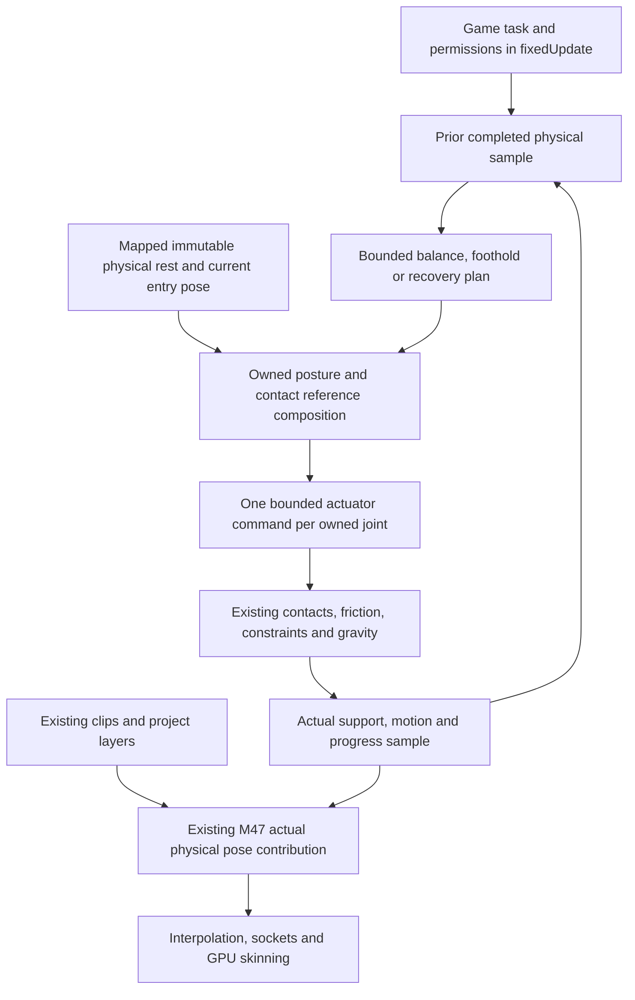

# Physical balance and bounded recovery

## Fixed phases and ownership

The controller does not own a root transform, external root force, capsule support,
render pose or game policy. A selected foothold is intent, not support. All joint
angular effort has paired reactions. Standing/step/recovery success requires
measured physical state and a dwell, independently checked in focused trials.
Configuration must not activate a task. Existing IK/physical-animation partial/active/passive and
ordinary CharacterMotor paths retain their supported meaning without balance.

## Control and numerical envelope

The controller samples each physical body once. COM and velocity are mass-weighted;
support points and point velocities are normal-impulse-weighted solved contacts.
Gravity directions must agree with the authored coherence threshold. Contact samples
are from the preceding completed solver interval, not predictions or query hits.

Tangent feedback is `cross(up, -(positionResponse * COMError + velocityResponse *
relativeVelocity))`, capped by `maximumLean`. Relative quaternion joint targets
produce implicit soft drive rows alongside normal contacts/joint constraints. Their
three component impulse bounds conservatively enforce the authored torque magnitude.
All drive reactions are paired between dynamic bodies; no world-anchored actuator
is permitted. Native mass, velocity and transform assignment is absent.

Near-equal support load impulses (within .1% of their sum) use stable authored
chain order; meaningfully lighter support is still selected. This avoids letting
compiler-level contact rounding flip an otherwise symmetric discrete plan.

A capture estimate `COM + tangentVelocity * sqrt(COMHeight / gravityMagnitude)`
selects a bounded translated foot placement. Normal ray/box queries are planning
only. Real stance load gates transfer; real loss of foot contact and >2.5 cm lift
are required before actual contact may complete touchdown. References use actual
joint anchors/hinge axes; they never move physics bodies. Standing requires two real
accepted supports, upright dot >.96, authored height/speed bounds and a 1 s dwell.

`plantedOrientationWeight` is an explicit 0..1 stance-reference setting. At zero
the controller retains the physical contacting face (needed by the multi-face
weighted-foot recovery fixtures). At one it uses the authored upright foot
orientation (tested on curved ground with single-point contacts). It changes
paired ankle targets, never creates support or modifies friction. Trying one
policy everywhere demonstrably failed; original failures are retained.

## Normal authoring and use

In the ordinary editor select an animated entity with its existing ragdoll mapping.
Under **Physical balance / recovery**, add the configuration, use the stable skeleton
pickers for two upper/lower/foot chains, and author actual contact patches in each
physical foot frame. Patch normal is outward, radius and offsets are metres. Clearance
half extents must contain the authored box foot. Root up/forward are root-local axes.
The controller does not infer humanoid anatomy or fit imported collision bodies.
All mapped bodies must be dynamic in full physical mode; non-adjacent self collision
retains normal authored filtering. The configuration shares scene/prefab identity and
Undo/Redo with other components. Merely adding/enabling it does not start physics.

Stiffness, damping, torque caps, support acceptance, transfer/dwell/deadline, step
reach/clearance and query filtering are authored generic parameters, not game states.
Use the ordinary script `requestBalance` only from a fixed update. Requests explicitly
relinquish a motor via `motorHandoff`; exiting native control does not silently resume
it. The lab's separate N command authorizes collision-checked motor return after an
independent actual-standing check. A refused placement retains physical authority.
The O compatibility control exercises existing partial physics with motor ownership;
L and the gold socket demonstrate ordinary layers and final resolved-pose reads.

No public unsafe bone memory, permanent pose ownership, root servo, foot pin or second
physics world is exposed. See [the current JS reference](judasjs/animation-ragdolls.md)
and [copyable task script](judasjs/examples/physical-balance.js).

## Bounds and lifetime

Native admission is limited to 128 configured runtime owners, 32 mapped bodies per
owner, two explicit disjoint three-body support chains, and eight contact patches per
foot. Body observations reject overflow at 32 contact samples / 64 candidate bodies;
they never manufacture support after dropping samples. The existing physics solver,
CCD and broadphase remain authoritative. Corrective landings cap at eight (default
three), load-transfer and attempt deadlines are finite, and each candidate uses the
existing bounded query path rather than a whole-world per-foot scan.

Configured mappings/scratch buffers are per instance. Modern saves retain semantic
task clocks, entry and landed references, plans and actual physical state. Guarded
new-format joint-bearing saves also retain selected numerical continuation and
actual completed observations; older slots and standalone history restoration
reacquire observations after a step. Broadphase ranges and general solver scratch
rebuild. Authored fingerprints remain unchanged; default-off scenes without live
joints retain their prior save representation. Active balances require a
versioned participant and reject malformed/missing/newer records before publication.
Native intent deliberately survives a game-script callback fault; destroying/disabling
its physical owner, asset replacement, invalid mapped body/support, or changing physical
authority releases its owned drives. Cancellation does not teleport, zero velocity,
re-enable a motor, or remove normal constraints.

Actual external support/foothold dependencies pin the region while needed. Complete
owner/assembly adoption derives transient bone ownership from the existing articulation;
individual bone adoption refuses. No new independently archived bone IDs are introduced.
mod admission retains existing exclusions; balance does not grant mod scripting privileges.

Natural humanoid get-up remains deferred: controller APIs and bounded standing
fixtures do not establish a general animation/contact-aware recovery system.
See [physical animation](RAGDOLLS.md) and [current limitations](CURRENT_FINDINGS.md).
