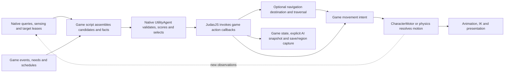

# Game AI: decisions and project-owned actions

Judas provides an optional Utility AI decision mechanism. It does not contain
predefined combat, hunger, personality, cover selection or social simulation.
Developers define candidate actions/targets and sensed facts; native scoring
selects a candidate. Ordinary project action callbacks perform the gameplay.
No machine learning, model download or external service is involved.

A tiny enemy can offer `patrol` and `hide`. A simulated person can offer meals,
beds, work and conversations. Both use the same decisions, action lifecycle,
cooldowns and inspection; the smaller project need not adopt the larger policy.

Start with the editable [Little Haven project](../projects/ai_workshop/README.md)
and the [JudasJS API](judasjs/ai.md). Navigation and movement remain existing
subsystems, not a second AI-owned physics engine.

## System map



This is one way to compose the systems. Each connection above is game-owned
unless the corresponding component or call explicitly supplies it. For
example, a script can use a handwritten state machine with navigation or can
use Utility AI for a stationary trader with no motor.

| System | Engine ownership and game-facing entry point | Game responsibility |
| --- | --- | --- |
| Utility decisions | `UtilityAgent` and `UtilityDecision` in [the JudasJS reference](judasjs/ai.md). [UtilityAI.cpp](../src/UtilityAI.cpp) validates and scores data, tracks selection/timers and produces diagnostics. [ScriptUtilityAI.cpp](../src/ScriptUtilityAI.cpp) owns native decision instances for their script slots. | Define what an actor values, offer relevant facts and candidates, choose when to call `tick`, and implement actions. |
| Action execution and events | The [JudasJS wrapper](../src/scripting/library/AI.h) dispatches synchronous action handlers. [Signals](judasjs/signals.md) delivers bounded phase-specific events. Physical events and animation markers have their own subscriptions or callbacks. | Implement action progress, effects and interruption. Signals can dirty observations or trigger game policy. They do not directly wake or reschedule a UtilityAgent. |
| Sensing and queries | `AISenses.sample`, `world.queryTags`, `world.overlap`, and [physics queries](judasjs/physics.md) use published state. `world.lightExposure` queries [direct lighting and collision occlusion](LUCIFER_V2.md), independently of shadow-map quality. | Select target and occluder layers, limits, cadence and meaning. Apply hearing, memory, faction, desirability and threat rules. |
| Target leases | `AITargetReservations` wraps the [world-session lease board](../src/AIReservations.cpp). A scope can acquire, renew, test and release a string key. Capacity and expiry are bounded. | Agree on stable resource keys, revalidate targets, renew only needed claims, and release them when finished. Job fairness and resource ownership remain game policy. |
| Navigation assets and runtime | [Recast/Detour navigation](NAVIGATION.md) provides authored area/profile filters, baked surfaces, source-owned terrain navigation, incremental TileCache obstacles, and links. `navigation.sample/path/raycast` query live surfaces. `entity.navigation` provides a `NavigationAgent` with a destination, progress, optional avoidance and advisory steering. [NavigationSystem.cpp](../src/NavigationSystem.cpp) owns routes and navigation state. | Select destinations and repath policy, handle failed/partial routes, submit movement, cross authored links and call `completeLink()`. Task selection and movement remain game-owned. |
| Physical movement and animation | [CharacterMotor](CHARACTER_MOTOR.md) resolves collision and gravity. Scripts may also use native kinematic/rigid/planar motion. [Animation](ANIMATION.md), animation events, IK and physical animation consume the same authoritative world and pose state. | Convert steering or intent into motion, choose gait/clip, and use animation/contact events to time gameplay. Utility AI does not own a skeleton or solver. |
| Persistence, streaming and fidelity | [SaveService and participants](PERSISTENCE.md) capture published state. [Streaming](WORLD_STREAMING.md) can suspend supported regions, and [native fidelity policy](../src/FidelityPolicy.h) can change the physics representation of eligible managed entities. [RuntimeWorld.cpp](../src/RuntimeWorld.cpp) applies the authored distance policy only when configured. | Keep resumable gameplay data in script `state`, reacquire live handles, and explicitly decide which distant decisions or outcomes to simulate. Physical fidelity policy is separate from scheduling AI callbacks. |
| Authoring and proof | The editor owns definition creation, authoring and live inspection. The [registered suite](../tools/validation/suites.json) covers `utility-ai`, `utility-ai-script`, `utility-ai-editor`, `utility-ai-application`, `ai-sensing` and `ai-sensing-script`. [Little Haven](../projects/ai_workshop/README.md) exercises real decisions, effects, save and lifecycle. | Use the app to qualify your policy with game outcomes and negative controls, such as a removed target or an unreachable route. |

The engine has no general behaviour-tree, GOAP, HTN, squad, dialogue, job
allocation or learned-agent runtime. Detour adaptive avoidance is local guidance
for participating navigation agents. The runtime uses Detour’s avoidance sampler within its own navigation-agent loop.
The engine's 2D physics/sensing APIs support planar actors, while baked
navigation is oriented surface navigation and has no volumetric swimming or
flying planner.

## Start with a selected object

In a script-owned project, select an empty object and open the
Inspector’s **Add gameplay script** section (open by default on a fresh object). Choose **Create AI behaviour**, enter a name, and create it. Judas
creates two normal Script assets in `Assets/Scripts`: a constrained `.ai.js`
definition (decision settings) and a `.js` behaviour (your action code), then
attaches the behaviour in one undoable scene operation.

A fresh 3D object gains a visible capsule and CharacterMotor. Three visible root
markers are wired as patrol, return and cover targets. Place a floor beneath the
actor and press Play. For an existing kinematic native 2D actor the starter uses
its real collider and authored plane. Existing rigid/dynamic ownership is rejected
with an explanation instead of silently converting a vehicle or physical assembly.
The starter moves directly with collision checks; it is not a pathfinder.

The Inspector gives separate **Decision settings**, **Action code** and
**Inspect this NPC** shortcuts. Live decisions can follow the selected object's
actual script ownership. A coordinator's agents remain owned by its coordinator;
Judas does not guess ownership from the visual object an action controls.

The generated patrol/hide example is ordinary readable game code. Send
`signals.send(npc, 'ai.damage', {amount: .6})` from your combat script to see the
hide action compete against patrol. Recovery and movement are script policy.
Target references, cancellation, one-second renewable claims and save restoration
are included. The embedded template is in `src/editor/AIBehaviourTemplate.h`;
no external template package is required. Undo removes scene setup while keeping
created source assets, as with existing editor script workflows.

## Authoring

An AI definition is a normal tracked Script asset with exactly this content shape:

```js
export default {
  "version": 1,
  "name": "Simple guard",
  "interval": 0.2,
  "switchAdvantage": 0.1,
  "actions": [
    {"id":"patrol","weight":0.2,"considerations":[]},
    {"id":"hide","weight":1,"minCommitment":0.4,"cooldown":1,
     "considerations":[{"fact":"health","curve":"inverse","min":0,"max":1}]}
  ]
};
```

Open **View > AI actions and decisions**. The **Author actions** tab edits this
constrained data format, validates it and saves the same
native definition used by scripts. It does not overwrite arbitrary JavaScript.
Import the module into a gameplay script and instantiate `UtilityAgent` with
project action handlers. Existing Script asset identity, dependencies and export
rules are reused.

Candidates are **action/target pairs**. Supplying three food sources allows target
distance, availability and quality to influence selection. Target strings are
opaque identifiers: AI does not dereference a target, assume a world axis or
teleport an NPC. The project must validate actual entity ownership/lifetime.

## Scores and eligibility

Each consideration normalizes its fact over `min..max`, clamps the input to 0..1,
and applies its response curve. Linear, inverse and power curves cover common
needs; weights and product/mean aggregation are explicit in the definition.
For curve response `r` and positive consideration weight `w`, product uses
`product(r^w)` and mean uses `sum(w*r)/sum(w)`. The action weight multiplies
the aggregate. Inputs normalize/clamp to [0,1]; eligibility remains separate.
Product aggregation makes a zero consideration veto the score. Mean aggregation
allows other considerations to compensate. These express different policies.

Eligibility is separate from score. A missing meal is not a very unattractive
meal: it is an unavailable candidate. Required facts, invalid facts and explicit
project eligibility produce inspectable reasons. Finite, valid sensor inputs are
required; invalid values must not become hidden winning scores.

Ties use lexicographic action ID, then target ID. Commitment, interruptibility
and switching advantage protect the current action while that exact candidate
remains eligible. On a due evaluation a missing or ineligible current candidate
can be replaced even during minimum commitment. Completion or leaving an action
starts its cooldown. Retargeting the same action exempts the newly selected
target from that action-wide cooldown. `finish('success'|'failure'|'cancelled')`
ends the current action and makes the next tick eligible to reevaluate.

The normalized definition allows 1–64 actions, up to 32 considerations and 32
required-fact names per action. A call can contain at most 256 candidate pairs
and 128 numeric facts per pair, subject to the native JSON byte budget.
Required facts must be finite and strictly positive. A missing consideration
fact makes the candidate ineligible. This separates absence from a valid
zero utility. The full [schema and input bounds](judasjs/ai.md) apply to
generated and manually authored definitions.

## Runtime ownership

An agent belongs to its creating script instance. Script retirement, reload and
world destruction cannot leave a native decision object bound to an old owner.
Actions release their own destinations, movement ownership, interaction handles
and temporary state in `stop`. Destroying a target must make the candidate
ineligible or cause a project action failure.

`start`, `update` and `stop` are project callbacks. `finish` reports success,
failure or cancellation; a chosen action may be interrupted according to its
configuration. No native action writes authoritative entity poses. Use existing
CharacterMotor, MK2 forces/kinematic movement, navigation and animation APIs.

AI is authority-neutral: in a network game, instantiate/tick authoritative AI on
the authoritative host. The decision framework does not automatically replicate
arbitrary agent state, project effects or client-side script closures.

## A decision from signal to completion

The [generated Patrol and Hide behaviour](../src/editor/AIBehaviourTemplate.h)
is a small working example of the whole lifecycle.

1. In `start`, the script constructs a named UtilityAgent and a target lease
   scope. It subscribes to the `ai.damage` signal. Its idle policy offers live
   patrol and return markers, with a low fixed weight.
2. A combat script sends a damage signal. On delivery the behaviour updates
   health, a game-owned fact. Nothing invokes UtilityAgent automatically.
   In `fixedUpdate`, the lazy candidate function supplies the two patrol pairs
   and an eligible `hide` pair when health is low and the cover marker is live
   and available. An inverse health curve raises hide's utility.
3. On the next due evaluation, native ranking may select hide. The wrapper
   calls the old action's `stop`, then the new action's `start`, then `update`
   during that synchronous call. The script claims the selected marker and
   reacquires it for movement. If the claim fails or the marker disappears,
   the action finishes as failure. Between evaluations the selected action
   still receives `update` on every supplied tick.
4. Once at cover, the script restores health over simulated time and calls
   `finish('success')` from `update`. The wrapper releases the action through
   `stop`, which clears intent and releases the claim. The next tick can select
   a new action. Inspect the live scores to distinguish a blocked target
   from one that simply ranked lower.
5. The starter stores a native decision snapshot and health in `state`. A
   restored action re-enters `start` on the next tick, resolves fresh handles,
   and reacquires its lease. The toy starter snapshots each tick for clarity.
   Use the persistence boundary and workload guidance below for larger populations.

## Execution and thread ownership

[Simulation.cpp](../src/Simulation.cpp) commits origin changes and runs
navigation before fixed scripts in the normal authoritative step. A navigation
agent's steering is prepared from the currently published pose and destination.
A destination assigned by that step's script is consumed by a later navigation
update. An explicit `navigation.path` call instead performs a synchronous query
at the call site. Fixed scripts publish movement intent before the configured
character/animation/physics work. Physics events and queued fixed signals
publish at their established boundary. These orderings make current script
writes observable to later operations in the same step.

The main-thread QuickJS context and the creating entity/script-slot generation
own the bindings. Tick and action callbacks execute synchronously there.
Candidate functions execute only when the wrapper's native due check says they
are needed. That wrapper still crosses the bridge on ordinary ticks, creating
a small result with current clocks, cooldowns and selection. An elapsed step
larger than the evaluation interval does one evaluation and preserves the
interval phase. It does not replay all missed choices. Holding a decision
longer through a larger interval leaves ordinary `update` callbacks running.
Skipping `tick` also pauses that agent's clocks and action execution.

The UtilityAI C++ evaluator is world-independent. Each live instance
mutates its state on each call. A script context can own up to 4,096 agents,
with at most 16 per slot. An agent started from a shared coordinator still
belongs to that coordinator's slot. Shared Detour queries and physics broadphase
scratch require owner-thread access in current world bindings. Worker-backed
asset decode and terrain preparation use immutable inputs and publish through
the normal world owner. Physics cast batches reduce dispatches and repeated
filter work while remaining synchronous. Current AI has no worker VM, job
queue for candidates, native decision scheduler or automatic policy to stop
distant scripts. A future parallel query path needs read-only inputs, separate
query scratch and deterministic result publication.

## Performance and determinism

Tick from a fixed simulation callback. Definitions have an explicit decision
interval; action execution can still run every fixed step. Supply a lazy candidate
function to avoid expensive sensing on non-decision ticks. Cache visibility,
nearby-target and path results as project facts when appropriate: comparing scores
is often cheaper than repeatedly discovering candidates.

Determinism requires identical definitions, ordered inputs and fixed-step calls.
This does not promise cross-platform bit-identical arbitrary JavaScript or physics.
Avoid wall-time-driven sensor state or unseeded random inputs in deterministic AI.
Bounds reject runaway definitions/candidate lists rather than silently dropping
possible winners. Set `initialDelay` in [0, interval] to stagger the first
evaluation deterministically (for example a stable agent index modulo a fixed
number of phases). This release provides per-agent cadence, not a global
wall-clock scheduler or an automatic sensing budget. Projects needing very
large populations should stagger updates
and measure sensing/action cost as well as native decision cost.

No agent means no decision evaluation. The framework does not run an unconditional
world scan or spawn sensors for projects that do not use it.

## Measured scaling on the Alpha V2.1.0 checkpoint

These are Linux Release measurements on a Ryzen 5 5600 at Experimental
`e1d153a0`. The synthetic figures summarize three runs with 120 timed fixed
ticks per run after warm-up. They measure script or evaluator work in isolation.
They provide context for budgets and cannot predict whole-game FPS. The
maintained [UtilityAIBenchmark](../tools/benchmarks/UtilityAIBenchmark.cpp)
reproduces the registered-slot and agent population rows.

```sh
cmake --build build --target judas_utility_ai_benchmark
./build/judas_utility_ai_benchmark
```

| Script-only workload | Median / p95 per fixed tick |
| --- | ---: |
| 100 registered idle callbacks, no UtilityAgent | 0.011 / 0.012 ms |
| 500 registered idle callbacks, no UtilityAgent | 0.061 / 0.065 ms |
| 100 agents, staggered 0.2 s decision interval | 1.49 / 1.55 ms |
| 500 agents, same per-agent workload | 7.72 / 7.95 ms |
| 100 agents, 1 s interval in the snapshot-frequency control | 1.14 / 1.28 ms |
| 100 agents, 0.2 s interval in the same control | 1.54 / 2.04 ms |
| Same control, snapshot every tick | 2.66 / 3.24 ms |
| Same control, snapshot every 60 ticks | 1.56 / 2.08 ms |
| 100 slots with only 20 live agents | 0.33 / 0.45 ms |
| 20 live agents with the other 80 script slots disabled | 0.32 / 0.44 ms |

The last two rows isolate a deliberate game scheduling decision and the extra
cost of visiting idle slots. They do not time a region unload, save, or cold
activation. Active gameplay must still run its time-sensitive maintenance
regardless of how often it asks for a new decision.

Native C++ tests with prepared candidate JSON measured 0.107 ms per due tick
at 4 actions, 2 considerations and 8 candidates. Raising actions to 64 while
keeping the same candidates increased that to 0.298 ms and raised native
snapshot cost from 0.013 to 0.168 ms. Raising considerations from 2 to 16 with
4 actions and 8 candidates increased a due tick to 0.462 ms. At the original
definition size, growing from 8 to 32, 128 and 256 candidates produced
0.107, 0.378, 1.484 and 3.067 ms per evaluation. Those values include native
validation, scoring, diagnostic construction and result JSON. JavaScript
candidate generation, pathfinding and world calls are outside that benchmark.

An interleaved follow-up on the same host retained the diagnostic output
while eliminating copies of immutable definitions and decision rows. Native
median due-tick time fell from 110 to 77 µs with 4 actions, 2 considerations
and 8 candidates, and from 3.07 to 2.49 ms with 256 candidates. In the
script-bridge benchmark, median steps fell from 1.49 to 1.40 ms at 100
active agents and from 7.71 to 7.16 ms at 500 active agents. These runs
measure fixed script work and exclude rendering and movement.

In a separate baseline lifecycle control, a four-action definition took about
0.036 ms to construct, 0.055 ms to restore and 0.007 ms to retire. At 64
actions those costs were about 0.53, 0.71 and 0.10 ms. These samples time one
fresh C++ agent and an already captured snapshot. VM setup, disk reads,
region publication and gameplay rehydration have their own costs.

On TWOJ's `Linux-20261122-171528` fixture, the default island views showed
no steady native UtilityAI calls in 38 sampled ticks. A separate disposable
Millbrook spawn exercised four resident `aiTick` calls per sampled step.
In 32 late-window thread-clock samples, all scripts accounted for 1.95 ms
of CPU inside QuickJS plus 1.66 ms in synchronous native calls. The native
`aiTick` entry averaged 0.257 ms per fixed tick including binding overhead.
Of that time, 0.055 ms was native scoring and selection with diagnostic
construction, about 0.060 ms was parsing the reply into JS, and about
0.059 ms was building outgoing JSON. A full snapshot averaged 0.048 ms when
called and about 0.010 ms per tick at the observed cadence. Explicit sensing
cost about 0.069 ms per tick and navigation update about 0.064 ms. Pre-physics
character motors cost about 1.33 ms. A separate sampled capture attributed
0.182 ms per tick to the game candidate function, including any engine
queries it made. Character callbacks took 3.15 ms inclusive and character
persistence within them took 0.069 ms. These overlapping measurements
describe composition of the fixed step. Compare the enclosing scopes only
once when accounting for frame time.

TWOJ owns its candidate lists, resident needs, job rules, crowd partitioning
and persistence cadence. The frozen export already snapshots on transitions
and evaluations and advances saved clocks from ordinary tick results between
them. It also requests detailed `inspection` after evaluated ticks, which
averaged 0.053 ms per fixed tick in this sample. An evaluated `tick` already
returns `candidates`. A game that needs the same evaluated rows can use that
return value, after checking how completion inside an action affects the
result, and avoid a second inspection and conversion.

### Next measured engine opportunities

1. **Reduce due-tick encoding.** Native evaluation shares the immutable
   definition, stages mutable decision inputs, and serializes the new
   diagnostic rows without deep-copying them for the reply. The script bridge
   still parses that reply into JS. A typed internal representation is worth
   evaluating for large active populations. Preserve scores, ordering,
   inspection and save bytes when comparing implementations.
2. **Bound broadphase candidate work.** `AISenses.maxCandidates` limits work
   after the broadphase has materialized matches. It is not a traversal limit.
   Profile dense fields before proposing a bounded world-query collector or
   shared read-only candidate data. Preserve deterministic ordering and the
   existing truncation contract. Normal cast batches already solve the common
   repeated-filter and bridge-crossing case.
3. **Profile avoidance at crowd scale.** Navigation accepts at most 32 nearby
   inputs per agent but can scan the ordered agent set to find them. A stable
   spatial index could help a large same-surface crowd. The measured Millbrook
   navigation share is small. Any worker experiment needs independent query
   state over an immutable published navigation revision.
4. **Keep cadence and persistence in game policy.** Use staggered decisions,
   lazy candidate functions, event-invalidated facts and safe snapshot
   boundaries before adding another scheduler. An engine request to
   reevaluate on the next fixed tick could be useful if a game cannot meet a
   measured latency requirement with current signals and intervals. Do not
   use `finish` as a generic wakeup. It completes or fails a real action.
   A native sensor, route or agent handle cannot be saved or transferred to a
   worker as an opaque continuation.

## Inspection and persistence

The **Live decisions** tab exposes every named runtime agent, independently of
scene selection, with the selected candidate, alternatives, rejection reasons,
consideration contributions and timing state. Inspecting does not change the
winner. Retained diagnostic data is bounded; it is not an unbounded event recorder.

Save `agent.snapshot()` inside the script's plain `state`, together with gameplay
progress. During `restore`, create fresh agents/handlers and call `restore` on the
matching snapshot. Definition identity/version checks prevent pretending an old
state is compatible with an unrelated definition. Restore never serializes a
closure or resumes a suspended JavaScript stack. An active action re-enters its
`start` handler on its next tick; handlers must rehydrate existing progress and
must not duplicate one-time rewards.

Regional suspension/reload follows existing script ownership and save boundaries.
Streaming captures ordinary script state before retiring a supported
region. Reconstructed owners get new script slots, native agents, sensors,
claims and navigation handles. Runtime routes and cached perception are
transient. A saved locator can resolve to null if the target is absent or
suspended. Persist semantic destinations, task progress and opaque
`saves.reference` strings, then reissue routes when they can be acted on.
A script using a coordinator owns the agents and leases it creates, even if
another entity is the visible actor. Region transitions cannot retire an
unrelated coordinator's handles on the actor's behalf.

Look up live targets again at execution time. UtilityAgent sees opaque
action/target strings and does not observe entity deletion. Sensors check live
body ownership before reusing observations. Reservations accept arbitrary keys
and have no automatic reference to a deleted target. Pause and unload policy
must decide which elapsed timers advance, which wait and when to reacquire.
Neither physics fidelity nor graphics quality is a substitute for those
decisions. Unsupported required world state still fails the existing
save/streaming contract.

## Optional observations and target ownership

`AISenses` performs bounded-result spatial observations of published physical
entities. Target filters and line-of-sight occluder layers are independent: a wall
need not have the food tag to block the sight of food. A zero/exhausted ray budget
returns `visible: null`, never an invented clear result. Timed cache reuse reports
its original sample time, age and `stale: true`. The cache checks retained
target identity, pose and filters, and invalidates on an origin shift. A
same-tick occluder change can outlive the sample. The candidate limit applies
before the radius filter and distance sort, so a truncated result is an
ordered subset of the inspected candidates. Check targets and time-sensitive
line of sight again before applying gameplay effects.

`AITargetReservations` provides exclusive world-session target leases. Different
instances are different claimants, including two instances in the same script.
One NPC can claim a bed, meal or work position while others make that candidate
ineligible. Leases use simulation time, support renewal/release and expire; no
wall-clock thread runs. Claims are released on script teardown/fault/reload before
action cleanup. They are transient: after loading, actions explicitly reacquire
instead of reviving saved ownership tokens or duplicating rewards.

These helpers do not decide who deserves a job, consume inventory, discover every
possible kind of target or coordinate a squad. See [API bounds and usage](judasjs/ai.md#optional-sensing).

## Initial boundaries

This is a utility/action framework, not a behaviour-tree graph, GOAP planner,
perception engine, crowd simulator or pathfinding replacement. Long sequences,
job queues, conversations and coordinated teams remain project policy. Exclusive
target leases are available; higher-level allocation/fairness policy remains yours. A chosen
attack still needs valid collision/hit timing; a chosen route can still fail.

Use runtime evidence to distinguish a bad score, missing fact, invalid target,
blocked action and unsupported world lifecycle. Do not assume a plausible-looking
NPC demonstrates save/export or multiplayer correctness.
