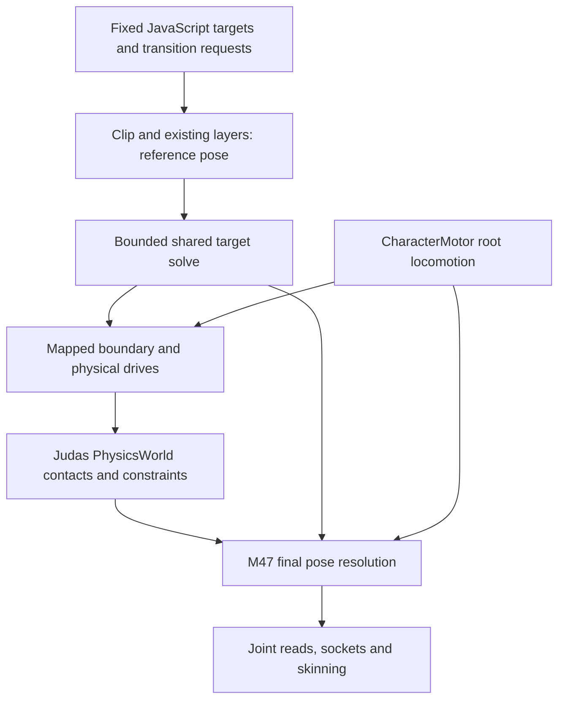

# Multi-target IK and physical animation

The runtime solves explicit target frames and drives mapped physical joints.
Project scripts own contact selection, actions, impacts and recovery. See
[the public API](judasjs/animation-ragdolls.md) and [qualification scope](DEVELOPMENT_READINESS.md).

## Ownership and actual fixed-step phases

Ordinary automatic animation samples in the post-physics boundary. Opted-in IK
and physical animation use a pre-physics
reference preparation only for instances using the new capabilities; it does
not advance playback twice or reorder the disabled legacy path.

| Phase | Owner and sample | Writes / authoritative result |
|---|---|---|
| `FixedScripts` | Project JS; prior completed authoritative joint/physics sample | Atomic mappings/target sets and physical-mode requests are submitted for the upcoming fixed boundary. A read here cannot see future physics. |
| Opted-in CharacterMotor update | CharacterMotor; desired velocity and actual support from normal authoritative geometry | For IK/physical-animation instances, root locomotion completes before reference/world-target conversion and anchor preparation. Full physical handoff explicitly disables the motor. |
| IK/physical-animation reference preparation | RuntimeWorld; current clip time advanced once, existing crossfade/layers and legacy limb IK, then shared target solve | One immutable-for-this-step reference pose. World targets use the authoritative entity/support sample, never a camera's interpolated matrix. Pelvis correction changes skeletal locals only. |
| Boundary and drives | Existing ragdoll/body/joint mapping; this reference pose | Validate requested authority transition before publishing it. Prescribed unselected anchors and bounded dynamic joint drives use explicit bone/body/COM frames. |
| `PhysicsWorld::Step` | Judas contacts, constraints, gravity and inertia | Dynamic mapped bodies receive the single authoritative physical result; target poses do not overwrite it. |
| Existing post-physics motor / body synchronization | Non-IK/physical-animation CharacterMotor instances and ordinary rigid body ownership | The disabled legacy path keeps its accepted ordering. An opted-in motor is not moved twice. |
| Physical pose resolution | RuntimeWorld; current physical bodies plus prepared reference | Convert mapped bodies back into hierarchical locals, compose through pose-composition once. IK is not reapplied after physics over owned joints. |
| Joint reads, sockets, skinning and presentation | Same final resolved pose; entity presentation interpolation for the requested sample | Sockets and GPU palettes consume the same final pose. Presentation/camera rate never drives physics. |

### Compatibility guarantees

- No IK/physical-animation configuration: accepted layer, crossfade, limb-IK, socket, root-motion
  and ragdoll semantics retain the original path.
- Immutable imported skeletons/clips/mesh bindings remain shared. Each instance
  owns its targets, reference, solve status and physical articulation.
- CharacterMotor, skeleton posing and articulated physics remain distinct.
- A skeletal pelvis correction never moves the entity/capsule/root-motion track.
- Uninvolved helper/finger/head-hidden branches are preserved; no universal up
  direction or anatomical names are inferred by the engine.

## Public API boundary

New batched configuration uses ordinary JSON tuples `[x,y,z]` and `[x,y,z,w]`.
Existing individual JudasJS vector methods retain `{x,y,z}` / `{x,y,z,w}`.

| API | Purpose |
|---|---|
| `entity.animation.configureIK(settings \| null)` | Atomically configure/clear explicit skeleton root/spine/chains/limits and target set. |
| `entity.animation.ikTargets(targets)` | Replace the bounded target set atomically. |
| `entity.animation.ikStatus` | Copied readiness, diagnostic and per-effector solve result. |
| `entity.ragdoll.configurePhysical(settings \| null)` | Atomically configure/clear physical region/drive settings. |
| `entity.ragdoll.setMode(mode, options)` | Request animation/partial/active/passive authority at a safe fixed boundary. |
| `entity.ragdoll.physicalState` | Copied mode, pending state, diagnostics, drive errors and saturation. |

Exact settings, caps, units, refusal/lifetime rules and executed examples are
documented in [the animation/ragdoll reference](judasjs/animation-ragdolls.md).
The lab consumes these public APIs, character-motor motor motion, named-authoring named authoring/import,
UI UI, save-slot saves and export packaging.

## Incremental adoption in an existing game

1. Keep the existing motor, clips, crossfades, Carry/head-hidden layers and socket
   attachments. Read `animation.info.joints` after `ready`, and author explicit
   keys/contact frames using the normal skeleton picker. Names in the lab are
   fixture data; do not copy them onto another rig.
2. Add shared IK alone first. `configureIK` declares the body-root/spine/chains
   and limits; `ikTargets` submits one complete set of desired palm/sole frames
   during `fixedUpdate`. Use authoritative support/entity transforms. Remove a
   support's targets if its safe handle is no longer valid. No ragdoll is needed.
`ikStatus.ready` denotes asset availability; target residuals appear after a real solve, including after cold restore.
3. Inspect each residual and `rootCorrection`, rather than relocating the whole
   character to force contacts. A fixed callback reads the previous completed
   result; newly submitted targets resolve at the upcoming reference boundary.
   Presentation joint/socket reads use the displayed sample only for visuals.
4. Add an ordinary explicit body/constraint mapping and one selected physical
   region. Keep the visual hidden head/helper branches intact; an unmapped visual
   joint needs no rigid body. `configurePhysical` plus `setMode('partial')` keeps
   the motor's root authority while actual dynamic joints respond to impulses.
5. Use `ragdoll.body(key)` and ordinary impulses for impacts. Set `effortWeight`
   to zero as the passive-effort control: physical motion still supplies the
   pose. `poseWeight` is a separate visual blend, not a way to disable physics.
6. Explicitly hand off the motor for full `active`/`passive` modes. Passive release
   preserves current physical motion. Return with a game-chosen, collision-valid
   placement and fade; handle refusal without overwriting physical state. No
   automatic recovery/get-up behaviour is provided.

The copyable [multi-target example](judasjs/examples/multi-target-ik.js) and
[physical-region example](judasjs/examples/physical-animation.js) run on the
approved lab fixture through the real VM. Adapt their mappings and target policy,
not their joint names, to a consumer game.

## Deliberate limits

- Shared IK is a bounded simultaneous damped solve, not a reachability guarantee.
  Impossible or mutually conflicting requests return a finite pose and explicit
  per-target residual/status. Limits are 12 targets, 64 participating joints and
  at most 96 iterations; the lab uses the ordinary 64-iteration setting.
- Positive uniform model scale is supported. Reflected, sheared or singular
  participating paths are rejected. Uninvolved hidden branches remain valid.
- Physical regions use the existing authored body/constraint mapping. Dynamic
  regions respond to gravity, contacts, inertia and capped relative torques;
  their bodies can lag or saturate instead of matching animation exactly.
- There is no balance, foot-placement policy, contact selection, automatic
  standing/recovery, or fixed-root full-body drive. Those meanings remain outside
  this milestone. The lab chooses targets and explicit return placement in JS.
- A live articulation cannot silently stream out as ordinary animation.
  Durable configuration/authority survives supported save restoration, while
  sampled target status and drive-motion history start fresh.
