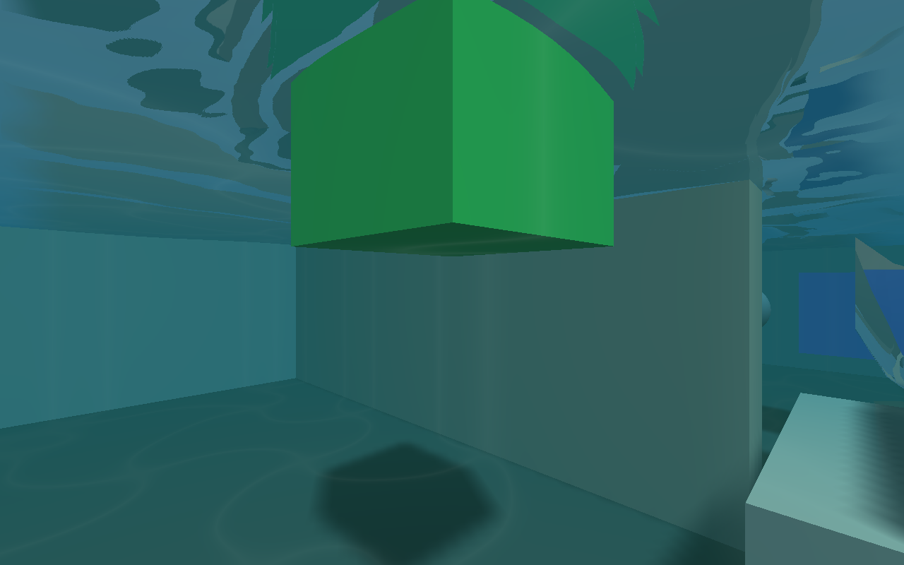

# Water V2 — wall striping and transient optical pockets

7 November 2026; Experimental only. Parent `f3648eab6cf404143763ab4d50072db0031c85af`.
Main and the Alpha fluid lock are unchanged. No solver, force, conservation,
save-format or gameplay-script changes. Human review of this correction is pending.

## Reproduced mechanisms and corrections

1. **Coplanar closing faces.** A finite water-domain side can occupy exactly the
   same plane as a pool wall. At grazing angles depth ties let fragments reflect
   and refract the wall onto itself. The closing-face shader now defers to opaque
   scene depth at that interface, using a millimetric visual precision tolerance.
   Geometry/collision positions are unchanged. An exposed water side still draws.
2. **One-cell optical continuation.** The previous fill reached only one cell
   into a moving-solid exclusion. A larger/held object could leave an unfilled
   centre. Deterministic multi-source fronts now continue through the connected
   exclusion, using wet witnesses across open static apertures. Ordinary dry
   cells, dry vertical layers and closed static walls remain excluded.
3. **False internal curtains.** Rising water around a body moves adjacent column
   tops into different Y cells. The old patch builder mistook those differences
   for separate footprints and generated vertical faces down to the floor. The
   reproduced capsule fixture contained **264 internal side vertices**. It now
   has **zero**, with the same physical cell heights and water quantity.

Surface topology now owns one patch per column water run. CPU/GPU interpolation
uses overlapping vertical run bounds, retaining separate actual layers. Dry
atlas entries carry next-wet-run links; wet runs skip directly to their end, so
lookup does not scan every vertical cell. No extra texture allocation is needed.

## Evidence

- Initial new controls reproduced the large-body gap and water-face mismatch
  (`before.log`). A wall-only change did not cure the internal curtain
  (`after-controls.log`); both representation problems were addressed.
- The final isolated negative control removes **only** opaque-wall precedence.
  It fails with **6,600 mismatching colour channels across 6,760 actual opaque
  wall pixels**. Restoring the correction gives **zero**. The comparison uses
  the same water with only hidden closing faces omitted as its reference.
- A separate exposed-side control retains a 157-channel summed centre-pixel
  difference from the no-side reference, proving closing faces were not simply
  removed globally.
- Native full visual/physical gate: **114 checks, 0 failures**, including four
  real Workshop scenes, close/grazing walls, surface crossings, disturbances,
  first entry with an adjacent held-body fixture and real camera-height offset,
  closed-wall/dry-side rejection, dry vertical gaps and quantity accounting.
- Forced portable **OpenGL 3.3**: **114 checks, 0 failures**. The strengthened
  production-shader oracle reconstructs the analytic field `h(x)=1.6+0.5*x`
  across different Y cells, including its slope; oracle error was approximately
  `3e-7`. It updates an old 1.6 m mesh to 2.10421 m including the known visual wave.
- The aligned native regression gate passed all **7** selections: visual water,
  grid physics, runtime lifecycle, JudasJS, actual Workshop controls, Basic Water
  and Alpha fluid policy. Render-pass state separately passed **28** checks.
- Genuine relocated export/cold-process save/load and scene/pause/reset controls
  passed (`cold/RESULTS.json`).
- The 300-frame gameplay replay matched every recorded **15 × 43-column** player
  and prop state sample against the preserved baseline exactly. This is sampled
  printed-state identity, not an exhaustive world-state proof.




`negative-wall.png`, `wall-with-sides.png` and `wall-reference.png` show the
controlled grazing comparison. These are agent inspections, not human acceptance.

## Performance

Release / GNU 15.2.0, Ryzen 5 5600, GTX 970 / NVIDIA 580.178.04, 8 GiB RAM,
1280×800. Same four authored scenes, 180 fixed steps each, real disturbance at
step 30; no competing game or compiler during measurement. GPU figures sum the
surface and underwater passes; 118 completed pairs per scene are retained.

| Scene | Water GPU median / p95 / worst ms | Visual field CPU median ms |
|---|---:|---:|
| Pool | 3.944 / 4.281 / 4.330 | 0.476 |
| Tilted | 4.628 / 4.845 / 5.019 | 0.475 |
| Radial | 4.572 / 4.783 / 4.977 | 0.456 |
| Original basin | 4.140 / 4.169 / 4.518 | 0.362 |

Simulation medians remain approximately 5.82–7.19 ms. This is a correctness
repair, **not a claimed rendering speedup**: some views cost more than the prior
presentation. CPU render/present includes display waits. Raw elapsed rows and
bounded profiler records are retained; their detailed-event budget limitations
are the same as the preceding qualification. Visibility culling and LOD remain.

## Preserved investigations and oracle corrections

The early head-on negative controls (`wall-negative.log`,
`exact-wall-negative.log`) did not trigger the grazing defect and are not counted
as failing negative controls. Decimal wall thickness could also place the wall
one float ULP forward; the final fixture uses an exactly coincident boundary.

`qualified.log` preserves a run failing three newly added assertions. One analytic
fixture put .7/2.3 boundaries exactly on float-rounded seed quadrature points;
the additional known-height fixture now uses .8/2.4 between sample planes. The
original dry-gap control is unchanged. The wall comparison initially included
legitimately exposed water beyond the finite wall; the final oracle masks actual
opaque depth, retains its original two-level colour tolerance, and separately
checks exposed sides. Its independent guard-removal negative control still fails.

`regressions/` records the validator declining executables with stale build
identities after test edits. All selected executables were rebuilt together;
`aligned-regressions/` contains the genuine passing run. No gate was suppressed
or counted as passed while unavailable.

## Reproduce / human review

```sh
cmake --build build --target judas judas_editor judas_export judas_water_visual_tests -j2
build/judas_water_visual_tests /tmp/water-wall-check --measure
JUDAS_GL_PROFILE=portable build/judas_water_visual_tests /tmp/water-wall-portable
build/judas projects/water_v2_workshop/water_v2_workshop.judasproj
```

Walk/swim alongside the walls at shallow angles; jump in repeatedly, then grab,
hold, move and release larger props underwater. Inspect all four scenes and save/
reload. Report any remaining visible pocket with its scene and held object.

Screen-space reflections/refraction and coarse shoreline/optical geometry retain
their [documented limits](../../WATER_V2_PRESENTATION.md). No new Windows, Android
or browser hardware qualification is claimed. The Experimental preview remains
separate from the locked Alpha path.
