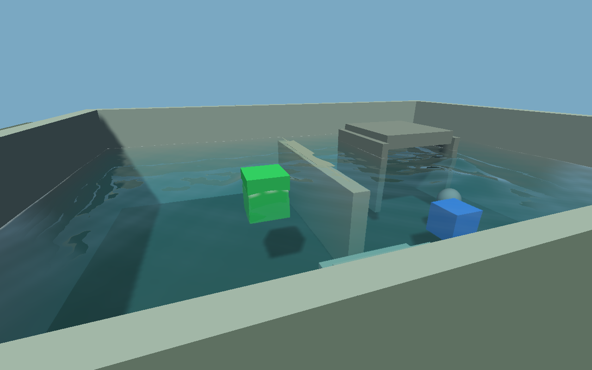
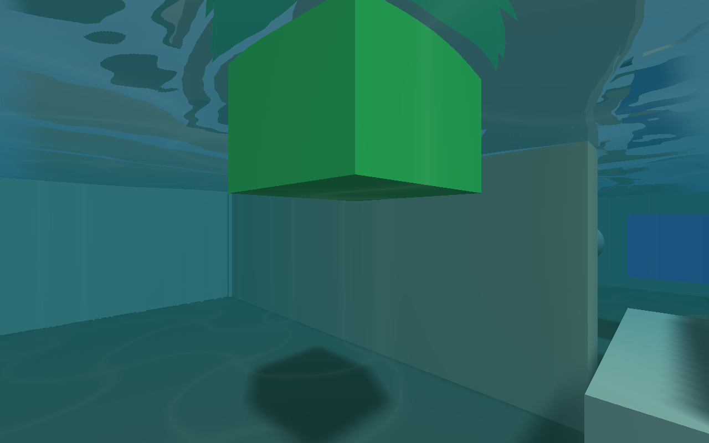
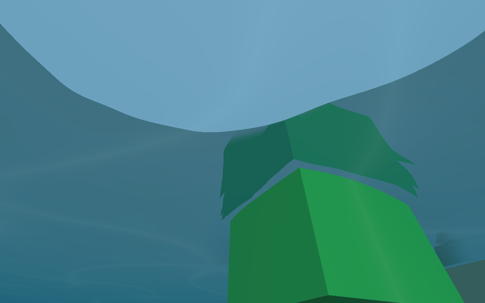
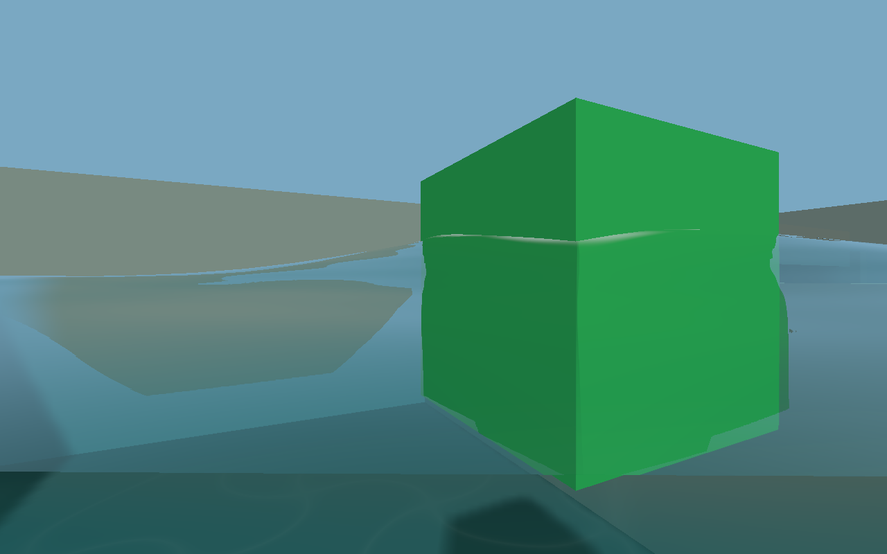

# Water V2 visual qualification — 7 November 2026

Experimental source preview; human visual acceptance is **pending**. Main and the
Alpha fluid lock are unchanged. Baseline: `110bba5181f5db9024b228a68d01cd59b4cbc3cb`.
Implementation file hashes and hardware are in `PROVENANCE.json`.

## What changed

The coarse grid still owns water quantity, pressure, transport and body loads.
The new presentation owns a separate continuous cubic surface, finer local
tessellation, GPU height/normal updates, animated detail, Fresnel reflections,
depth-aware refraction and colour, shoreline cues, and underwater attenuation.
There is no numerical solver replacement in this change.

Consecutive wet cells are reconstructed as one visible column. A swimmer's
physical exclusion no longer appears as an optical hole around the camera.
Continuation requires an open static connection; a closed-wall/dry-side negative
control is retained. Actual dry layers remain separate. Underwater compositing
runs after world effects, before colour output and HUD, with matching wave phase
and a blended near-plane waterline. Camera buffers and GPU state are restored.

Fine work is visibility/layer culled. Three distance LOD meshes and one field
revision are shared across views. Ordinary height changes update the GPU field,
not every fine vertex. Topology changes still rebuild a bounded surface. Shared
corner sampling and stack-based clipping remove repeated stencils/allocations.
Hidden physics continues where required for flow and gameplay.

See [presentation architecture and limits](../../WATER_V2_PRESENTATION.md).

## Actual visual inspection

The real Workshop was rendered from above, grazing the surface, seven crossing
heights, underwater looking horizontally/up/down, and beside shore steps, before
and after physical disturbances and a quantity-accounted source. This was repeated
for the ordinary, tilted, radial and original planet-basin scenes. The native
gameplay replay also walked, looked and submerged through normal game scripts.

Inspected captures show a continuous reflective/refracting interface and
underwater depth haze/caustic cues, without the old per-cell flat tiles or the
camera's capsule cavity. The below-surface sky window and distorted props are
refraction, not missing geometry. This inspection is agent visual QA, **not**
operator acceptance. Full-resolution examples:






The original appearance is preserved in `baseline-above.png` and
`baseline-submerged.png`. Additional captures cover disturbance, tilted steps,
radial water and the original awkward basin.

## Measurements

Release build, Ryzen 5 5600, GTX 970 / NVIDIA 580.178.04, 8 GiB RAM, 1280×800.
Each scene advances 40 warm-up steps, then 180 measured 1/60 s steps with a real
impulse at step 30. Views are submerged during the timed interval. No compiler or
other qualification game ran during the final measurement. These are bounded
fixtures, not a promise for maximum-size regions or arbitrary multi-view scenes.

| Scene | Simulation CPU median / p95 / worst ms | Water GPU median / p95 / worst ms |
|---|---:|---:|
| Pool | 7.105 / 7.440 / 8.132 | 3.842 / 4.022 / 4.249 |
| Tilted | 7.090 / 7.287 / 7.744 | 3.813 / 3.911 / 4.223 |
| Radial | 7.190 / 7.380 / 8.321 | 3.791 / 3.985 / 4.175 |
| Original basin | 5.823 / 6.336 / 7.690 | 4.121 / 4.147 / 4.558 |

CPU includes normal gameplay and physical water; GPU sums surface and underwater
passes, including their snapshots. CPU render-and-present medians were
9.81–11.20 ms, **including display waits**, so they are not GPU costs. Raw 180-step
rows are in `timings.csv`. The bounded profiler retains its final 120 frames;
`summary.json` uses 118 completed surface/underwater GPU pairs per scene. Detailed
physics event records exceeded its event budget; relevant water scopes and the
independent elapsed rows are retained. No claim of exhaustive physics attribution
is made.

Per-revision CPU field preparation medians were 0.35–0.46 ms. The final retained
frames rebuilt the pool/tilted/radial topology 5/6/8 times, with median rebuilds
4.97/3.53/3.63 ms and worst 5.74/3.72/3.73 ms. The original basin did not rebuild
in that retained interval. Footprint changes remain an occasional CPU cost.

An isolated, alternating-order comparison of the old/new mesh builder used 20
pairs per fixture. Median construction changed 1.163→0.557 ms for a level pool,
0.960→0.461 ms for a clipped footprint, and 1.565→0.761 ms for the tilted fixture.
This measures **mesh construction only**, not a doubling of whole-game speed.
All 216,402 ordered vertices across 18 meshes/subdivision settings matched exactly
in position, normals, UVs and layer payload. Source, commands and paired rows are
retained here.

Requested water texture storage was 9,273,344 bytes (8.84 MiB); this excludes mesh
buffers, driver overhead and other renderer resources. Peak sampled process RSS
was 177 MiB including the enabled profiler. Scratch allocations are reused for
smaller views. No physical particle population was added for visual detail.

## Qualification

- Native NVIDIA visual/gameplay gate: **105 checks, 0 failures**. This includes
  capture checks; it is not 105 independent physical tests.
- Forced OpenGL **3.3 portable** path: **105 checks, 0 failures**. Later corner
  caching is independently proven geometry-identical and rerun natively.
- Production vertex shader transform feedback agrees with its independent CPU
  height/normal oracle; a retained 1.6 m mesh follows a 1.7 m field on the GPU.
- White-geometry pixels attenuate with distance: dry red 255, near red 234, far
  red 186; clear-water red 255. Objects drawn after water have identical final
  colour. Foreign sampler/depth/blend/cull/texture state is preserved.
- Each original fixture performs **no** visual field, mesh, upload or optics work
  when outside the camera frustum.
- Existing grid / runtime / scripting: **28 / 41 / 5** checks passed.
- Workshop real controls: **25**; shader library **47**; rendering architecture
  **44**; cameras **59**; render-pass state **28** passed.
- Basic Water preview **26**; project water policy **56**; fluid policy **26**;
  editor settings gate passed. The normal Alpha lock remains in force.
- Python validation/policy/build organization: **51 tests**, 2 explicitly skipped
  Ninja-only controls in this Makefiles configuration, no failures.
- A 300-frame normal gameplay replay matched all **15 logged × 43-column** player
  and prop state samples exactly against the immutable previous runtime. This is
  sampled printed-state identity, not a claim of exhaustive bitwise world state.
- Genuine separate-process save/load from a relocated export passed, including
  pump state, source/drain receipts, water ledger and scene/pause/reset controls.
  Restored water was 181.5280084162945 m³, with no paused/error region.
- Native editor opened the disposable exported project, ran 120 Play frames,
  stopped, confirmed the authored scene **IDENTICAL**, and saved successfully.

Raw logs and machine-readable results accompany this report. Graphics logging
reported existing `shadowWorldDx/Dy` shader warnings; no new water GL errors or
GPU reset was observed. This does not certify that a driver cannot crash.

## Preserved failures and limits

`retained-multiview-first.log` contains an initially incorrect conservation oracle:
it compared across a legitimate physics step. The corrected check compares
immediately before/after const reconstruction; no physical tolerance was relaxed.
`retained-atlas-multiview.log` records a GPU fixture that incorrectly assumed a
cell-centre FillBox seeds an exact 1.7 m plane. The independent render-field
fixture now prescribes that known answer explicitly. `retained-qualified-measured.log`
is an interrupted software-renderer attempt, excluded from performance claims.
`retained-build-composite-final.log` records an intermediate archive link failure;
the subsequent complete rebuild passed. Neither is concealed as a passing run.

Screen-space reflections/refraction have offscreen/occlusion limitations and use
sky/environment fallback. Transparent objects do not receive exact layered water
refraction. Shorelines/optical voids approximate the coarse field; visual waves
do not change physical height or mass. Detailed foam/spray, free-falling liquid
sheets, global oceans and universal moving-container support are not claimed.
Water colour/opacity are authorable; the small wave/caustic style remains built
in. Windows, Android and browser hardware were not newly qualified in this pass.
Existing physical support limits remain documented; this is not an Alpha unlock.

## Reproduce and human checklist

```sh
cmake --build build --target judas judas_editor judas_export judas_water_visual_tests -j2
JUDAS_GPU_DIAGNOSTICS=1 build/judas_water_visual_tests /tmp/water-visuals --measure
JUDAS_GL_PROFILE=portable build/judas_water_visual_tests /tmp/water-portable
python3 tools/validation/qualify_water_workshop.py --runtime build/judas \
  --exporter build/judas_export \
  --project projects/water_v2_workshop/water_v2_workshop.judasproj \
  --output /tmp/new-relocated-water-check
build/judas projects/water_v2_workshop/water_v2_workshop.judasproj
```

1. Walk around the pool; inspect distant, close and grazing views for cell edges.
2. Swim down/up repeatedly; look horizontally, down and up through the surface.
3. Pick up/throw props with G/H, splash with B, and toggle circulation with F.
4. Inspect steps/shorelines and all four scenes with 1–4; compare the awkward basin.
5. Save/restart/load with F6/F7 and judge the moving presentation/performance.

Do not unlock fluids or promote main on the strength of automated checks alone.
