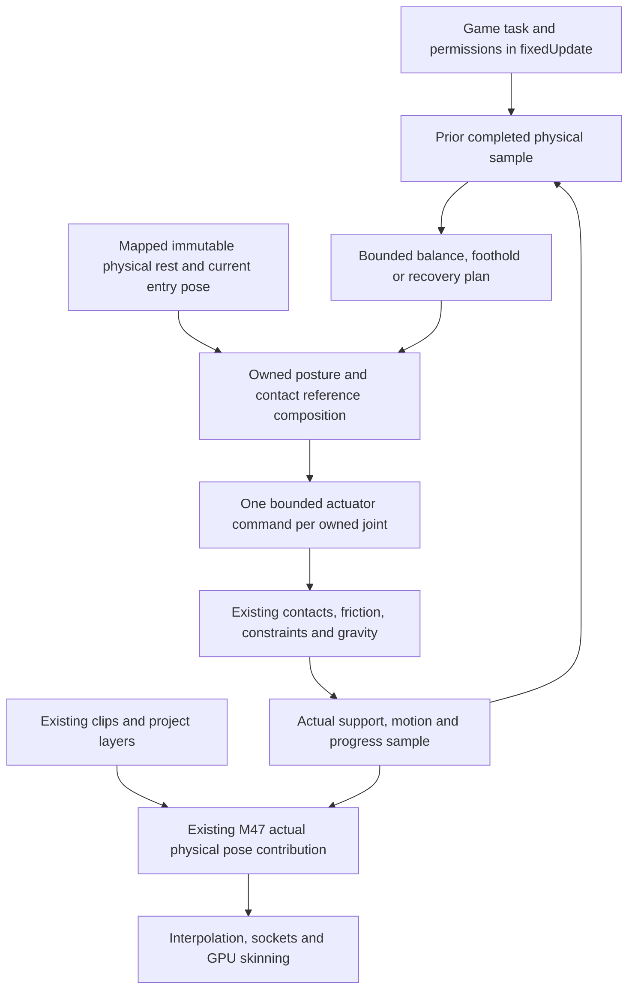

# M77 — physical balance, corrective stepping and bounded recovery

**M77 checkpointed by operator instruction. NOT HUMAN VALIDATED / NOT HUMAN TESTED.**
Automated Linux and native Windows VM evidence retains its recorded scope.
Physical Windows GPU/input acceptance remains outstanding. Implementation base:
`ab3dfbab13585680a9e6cc92fa318c8d95012979`. M76, M74 retargeting and M67's
specified deferred human reviews remain pending. M75 acceptance is independent.
Lastlight/Wayfarer, historical evidence and accepted fluid work are preserved.

## M77 checkpoint capability and current correction status

The M78 combined working candidate now reproduces a corrective-step regression on Linux and native Windows. Original M77 passes remain historical evidence; they do not certify the changed physics candidate. See [M78 follow-up](M78_FOLLOWUP.md) for current results and the bounded next proposal.

M77 provides default-off, explicit two-chain physical balance, bounded corrective
steps and physical rest-reference get-up. It uses the existing fully dynamic
articulation, gravity, contacts and M45 constraints. It does not pin feet, servo
root position, replace the skeleton, or promise general humanoid walking/recovery.

The ordinary [Balance Lab](../projects/balance_lab/balance_lab.judasproj) contains
standing, support, fallen-recovery and radial scenes. Three original mechanical
rigs make the physical envelope visible: two weighted-foot rigs recover, while
one slender rig demonstrates a narrow corrective-step envelope. Failure cases
include frictionless support, excessive perturbation, blocked recovery and
incoherent body gravity. Denied tasks report finite failure and release drives.

Linux clean affected Release, native/controller checks, real-GL/public-JS lab
checks, fresh-process saves, actual Application save/reload/transitions, editor
Play/Stop and a moved export with source hidden have passed. Native Windows Release build and 27 focused core/application/editor/save/export
cases pass, including the corrected step and a source-hidden Unicode moved package.
VM software rendering never establishes hardware/input acceptance. No unrelated full production-suite run or human acceptance
is claimed.

See [candidate results and capability boundaries](evidence/m77/final/RESULTS.md),
[performance](evidence/m77/final/PERFORMANCE.md), and the controls/checklist below.
Earlier failed probes and corrected follow-ups remain in
[the development record](evidence/m77/DEVELOPMENT.md).

## HISTORICAL — foundation preflight before the completed M77 candidate

| Capability | Decision | Source and reason |
|---|---|---|
| Authoritative articulated motion | Reuse | `PhysicsWorld`, M45 constraints, existing ragdoll body/bone mappings; no second world or skeleton. |
| Physical publication | Reuse | `WorldRagdoll`, M47 final contribution, current presentation and sockets; actual body pose remains full weight. |
| Mode/motor handoff | Reuse/extend narrowly | M70 validated fixed-boundary requests and collision-checked explicit motor return. |
| Clip/layer/shared IK references | Reuse | `WorldAnimation` and explicit M70 chains; references are inputs, never achieved contacts. |
| Contact support observations | Extend | Native solved contact rows/cache contain identities/impulses missing from coalesced public events. Read bounded body samples through broadphase-selected cache ranges; no ray-as-support substitution. |
| Bounded angular actuation | Extend | Optional relative quaternion drive rows solved with existing contacts/joints. Initial free-root experiments expose collapse with independent pre-integrated posture torques. Existing M70 remains unchanged when absent. |
| Balance/step/recovery tasks | Planned, not implemented | Authored two-legged mappings, actual COM/motion/contact observations, stance-local references, bounded plans and physical completion gates. No anatomy-name convention or game state. |
| Gravity and moving supports | Reuse | Per-physical-body gravity selections, authoritative body/COM point velocity, normal friction/reactions; no owner-only gravity assumption or motor carry in full physical mode. |
| Authoring/resources | Reuse/extend | Named scene/prefab fields, inspector stable skeleton keys, immutable assets, normal AssetDatabase/export. |
| Durable task lifetime | Extend | Existing M61 participant/chunk/reference validation; semantic task/planning history retained, observations/caches reacquired. Default-off old saves retain compatibility. |
| Regions/mod contracts | Reuse with explicit admission review | Existing whole-articulation pinning and M76 exclusions remain; no individual bone adoption or broadened permissions. |

## Fixed phases and ownership

The controller does not own a root transform, external root force, capsule support,
render pose or game policy. A selected foothold is intent, not support. All joint
angular effort has paired reactions. Standing/step/recovery success requires
measured physical state and a dwell, independently checked in focused trials.
Configuration must not activate a task. Existing M70 partial/active/passive and
ordinary CharacterMotor paths retain their supported meaning without M77.

## HISTORICAL — early foundation development status

Current experiments and failures are recorded in
[the development log](evidence/m77/DEVELOPMENT.md). Quantitative envelopes,
public configuration/API, persistence and final evidence are not yet established.
The native foundation check has 32 passing checks. The normal incremental Release
build and existing M70 physical-animation regression also pass (64 checks).
This is not the clean full-engine candidate build or final candidate validation.

One narrow mechanical recovery experiment succeeds with an explicitly heavy,
cubic-foot robot in both fallen orientations and nearby starting rotations.
Its effort-off controls remain fallen. The lighter slender-foot probe does not
recover. Neither is an integrated M77 controller or a completed lab demonstration.
Corrective stepping, the second rig, fixed-phase integration, public API,
authoring, durable task saves and platform/lifecycle proof remain outstanding.
No complete M77 acceptance or platform-validation claim is made here.

## Control and numerical envelope

The controller samples each physical body once. COM and velocity are mass-weighted;
support points and point velocities are normal-impulse-weighted solved contacts.
Gravity directions must agree with the authored coherence threshold. Contact samples
are from the preceding completed solver interval, not predictions or query hits.

Tangent feedback is `cross(up, -(positionResponse * COMError + velocityResponse *
relativeVelocity))`, capped by `maximumLean`. Relative quaternion joint targets
produce implicit soft drive rows alongside normal contacts/M45 constraints. Their
three component impulse bounds conservatively enforce the authored torque magnitude.
All drive reactions are paired between dynamic bodies; no world-anchored actuator
is permitted. Native mass, velocity and transform assignment is absent.

Near-equal support load impulses (within .1% of their sum) use stable authored
chain order; meaningfully lighter support is still selected. This avoids letting
compiler-level contact rounding flip an otherwise symmetric discrete plan.

A capture estimate `COM + tangentVelocity * sqrt(COMHeight / gravityMagnitude)`
selects a bounded translated foot placement. Normal ray/box queries are planning
only. Real stance load gates transfer; real loss of foot contact and >2.5 cm lift
are required before actual contact may complete touchdown. References use actual
M45 anchors/hinge axes; they never move physics bodies. Standing requires two real
accepted supports, upright dot >.96, authored height/speed bounds and a 1 s dwell.

`plantedOrientationWeight` is an explicit 0..1 stance-reference setting. At zero
the controller retains the physical contacting face (needed by the multi-face
weighted-foot recovery fixtures). At one it uses the authored upright foot
orientation (tested on curved ground with single-point contacts). It changes
paired ankle targets, never creates support or modifies friction. Trying one
policy everywhere demonstrably failed; original failures are retained.

**HISTORICAL — M77 checkpoint measurements, before M78 corrections.**
The complete seven-body no-contact audit retains ordinary solver numerical limits:
paired ±10 N m input torques, no applied gravity, 240 intervals at 60 Hz. Net linear
momentum residual stayed below 3e-6 kg m/s. Angular residual at interval 240 was
.03706 kg m²/s with control effort off and .04081 with it on. The inherited rigid
solver integrates orientation without gyroscopic angular-momentum transport and
uses constraint corrections. These are not exact global angular conservation
claims. The separate shared-axis actuator check measures paired angular reaction
within 1e-5; no new unpaired root wrench was added.

The M78 working candidate corrects the inherited free-body angular transport; these original M77 measurements remain evidence, not current-source results. Contact/constraint residuals are still approximate. See [the corrective follow-up](M78_FOLLOWUP.md).

## Normal authoring and use

In the ordinary editor select an animated entity with its existing ragdoll mapping.
Under **Physical balance / recovery**, add the configuration, use the stable skeleton
pickers for two upper/lower/foot chains, and author actual contact patches in each
physical foot frame. Patch normal is outward, radius and offsets are metres. Clearance
half extents must contain the authored box foot. Root up/forward are root-local axes.
The controller does not infer humanoid anatomy or fit imported collision bodies.
All mapped bodies must be dynamic in full physical mode; non-adjacent self collision
retains normal authored filtering. The configuration shares scene/prefab identity and
Undo/Redo with other components. Merely adding/enabling it does not start physics.

Stiffness, damping, torque caps, support acceptance, transfer/dwell/deadline, step
reach/clearance and query filtering are authored generic parameters, not game states.
Use the ordinary script `requestBalance` only from a fixed update. Requests explicitly
relinquish a motor via `motorHandoff`; exiting native control does not silently resume
it. The lab's separate N command authorizes collision-checked motor return after an
independent actual-standing check. A refused placement retains physical authority.
The O compatibility control exercises existing partial physics with motor ownership;
L and the gold socket demonstrate ordinary layers and final resolved-pose reads.

No public unsafe bone memory, permanent pose ownership, root servo, foot pin or second
physics world is exposed. See [the current JS reference](judasjs/animation-ragdolls.md)
and [copyable task script](judasjs/examples/physical-balance.js).

## Bounds and lifetime

Native admission is limited to 128 configured runtime owners, 32 mapped bodies per
owner, two explicit disjoint three-body support chains, and eight contact patches per
foot. Body observations reject overflow at 32 contact samples / 64 candidate bodies;
they never manufacture support after dropping samples. The existing physics solver,
CCD and broadphase remain authoritative. Corrective landings cap at eight (default
three), load-transfer and attempt deadlines are finite, and each candidate uses the
existing bounded query path rather than a whole-world per-foot scan.

Configured mappings/scratch buffers are per instance. Saved semantic task clocks,
entry and landed references, plans, and actual physics survive cold restoration;
contact observations, broadphase ranges and solver scratch are reacquired. Default-off
scenes retain their prior fingerprint/save representation. Active balances require a
versioned participant and reject malformed/missing/newer records before publication.
Native intent deliberately survives a game-script callback fault; destroying/disabling
its physical owner, asset replacement, invalid mapped body/support, or changing physical
authority releases its owned drives. Cancellation does not teleport, zero velocity,
re-enable a motor, or remove normal constraints.

Actual external support/foothold dependencies pin the region while needed. Complete
owner/assembly adoption derives transient bone ownership from the existing articulation;
individual bone adoption refuses. No new independently archived bone IDs are introduced.
M76 admission retains existing exclusions; M77 does not grant mod scripting privileges.

## Controls and human review

Open `projects/balance_lab/balance_lab.judasproj` in the editor or launch the
exported package. F1–F4 select flat/support/fallen/radial scenes; Tab selects an
actor. Mouse orbits the script-owned presentation camera. Esc pauses.

| Control | Meaning |
|---|---|
| P | Cancel native effort and enter passive physics; explicitly hand off motor. |
| B / G | Request physical standing / physical recovery. |
| U / J / K | Small / stepping-envelope / excessive genuine root impulse. |
| T / Y | Toggle stepping / effort permission for the next request. |
| Q / E | Rotate / reverse the next authored impulse direction. |
| N | Separate collision-checked return to animation/motor, after actual standing. |
| O / L | Existing partial-physics compatibility / masked rest layer. |
| WASD | Script-driven motor after explicit return. |
| Z / Delete | Spawn another prefab / remove selected support. |
| F5 / F6 / F7 / R | Diagnostics / save / load / reload. |

1. F1: select Stride, P, allow effort/stepping, B; wait for measured standing,
   then J. Confirm actual foot lift/contact and recovery. Reload and repeat with
   stepping denied; the same disturbance should exceed its standing envelope.
2. Tab through independent rigs. U is a small disturbance; K deliberately exceeds
   the bounded controller. P must stop effort without removing physics.
3. F2: exercise moving/rotating, uneven, sloped and obliquely oriented supports.
   Confirm no foot anchors or global-up assumption; delete support and observe
   safe failure. The frictionless F1 actor is an intentional negative case.
4. F3: request G on the two clear fallen weighted-foot rigs. Confirm physical
   get-up from their actual pose. The low-roof rig must fail honestly, not pass
   through its obstruction. The slender rig is not a universal get-up proof.
5. F4: activate a weighted-foot rig and confirm local radial gravity/curved
   support. Owner-only gravity selection does not silently override bone bodies.
6. After actual standing use N; inspect the normal visual fade and motor return.
   Check O, L and the socket indicator without taking native actuator ownership.
7. Spawn an independent prefab; save/load during standing, a step and recovery;
   pause, reload, switch scenes and Stop. Check no stale bodies or drives.
8. Repeat representative cases in the moved standalone. Windows VM proof is
   separate from real Windows GPU/input and operator acceptance.

Suggested commit after operator approval: `Add M77 physical balance and recovery`.
**HISTORICAL — original M77 handoff:** no commit, push or tag had been made at that handoff, and M78 had not started. The later M77 checkpoint and current M78 correction status are recorded above.
